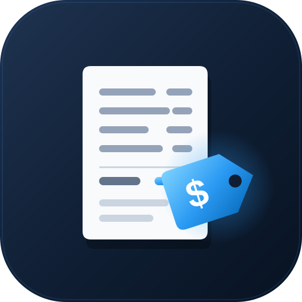

<p align="center">
  
</p>

# azure-pricing-skill

[](LICENSE)
[](https://nodejs.org/)

> **Ask "how much would this cost in Azure?" and get a finished, itemized estimate.** Your AI
> agent asks a few plain-language questions; a deterministic pricing engine pulls live Azure
> retail prices, applies your discount, checks the design against published Microsoft guidance,
> and hands you one self-contained HTML estimate.

`azure-pricing-skill` is an **agent skill** for GitHub Copilot (and other agents that read skills
from `.github/skills/` or `~/.copilot/skills/`). It is built for people who are new to Azure: they
describe what they need, not SKU names, and the skill does the rest.

## Contents

| | Section | |
|---|---------|---|
| 🚀 | [Quick start](#quick-start) | Install + first estimate in two steps |
| 📦 | [Installation](#installation) | Prerequisites and 5 install options |
| 💬 | [How it works](#how-it-works) | What the conversation looks like |
| 🤖 | [Which AI model to use](#which-ai-model-to-use) | Recommended, workable and blocked models |
| ✅ | [Why you can trust the numbers](#why-you-can-trust-the-numbers) | Engine math, readback, verified answers |
| 📚 | [Advice backed by Microsoft guidance](#advice-backed-by-microsoft-guidance) | 97 cited rules |
| 🖥️ | [VM sizes: Current and Extended only](#vm-sizes-current-and-extended-only) | End of Life sizes are never priced |
| 🧩 | [Coverage](#coverage) | Services the engine prices |
| ⚠️ | [Limits](#limits) | What it is and is not |
| 🛠️ | [CLI reference](#cli-reference) | Setup commands |
| ⚙️ | [Advanced](#advanced-running-the-engine-directly) | Running the engine directly |
| 🧪 | [Testing](#testing) | How it was tested |
| 📁 | [Repository structure](#repository-structure) | File tree |
| 🔒 | [Privacy & data](#privacy--data) | What it reads and sends |
| 📄 | [License](#license) | MIT |

---

## Quick start

**1. Add the skill** (one command, runs straight from GitHub):

```bash
npx github:chrislittle/azure-pricing-skill init --global
```

> The `npx` commands in this README are identical in **bash**, **zsh**, and **PowerShell**.

**2. Pick a recommended model and ask.** In GitHub Copilot CLI, choose the model with `/model`
(see [Which AI model to use](#which-ai-model-to-use)), then:

> **You:** *"How much would a Red Hat server with 64 GB of RAM and 2 TB of storage cost in East US 2?
> We get 16% off list."*
>
> **Agent:** *…asks a couple of questions, shows you the numbers to confirm, prices it…* →
> hands you **one HTML estimate** with options side by side.

---

## Installation

### Prerequisites

- **[Node.js 18+](https://nodejs.org/)**, the only requirement (it ships with GitHub Copilot CLI).
  Check with `node --version`.
- **Internet access to `prices.azure.com`.** No Azure sign-in, subscription or API key is needed.
- **An AI agent** that reads skills from `.github/skills/` or `~/.copilot/skills/` (for example
  GitHub Copilot CLI).

`init` checks these for you.

### Option A: Global install (recommended)

Available in every folder you work in:

```bash
npx github:chrislittle/azure-pricing-skill init --global      # -> ~/.copilot/skills/azure-pricing
```

### Option B: Project install

Adds the skill to the **current** repo under `.github/skills/azure-pricing`. **cd into your repo first:**

```bash
cd my-repo
npx github:chrislittle/azure-pricing-skill init
```

### Option C: Explicit path

```bash
npx github:chrislittle/azure-pricing-skill init --dir /any/path/azure-pricing
```

### Option D: Global command via npm

```bash
npm install -g github:chrislittle/azure-pricing-skill

azure-pricing-skill init --global
azure-pricing-skill status
azure-pricing-skill --version
```

### Option E: Manual install (offline / no npx)

Copy the repo into your agent's skills folder.

**bash / zsh (macOS, Linux):**

```bash
git clone https://github.com/chrislittle/azure-pricing-skill.git
mkdir -p ~/.copilot/skills/azure-pricing
cp -r azure-pricing-skill/{SKILL.md,MANIFEST.json,scripts,catalog,assets} ~/.copilot/skills/azure-pricing/
```

**PowerShell (Windows):**

```powershell
git clone https://github.com/chrislittle/azure-pricing-skill.git
$dest = "$env:USERPROFILE\.copilot\skills\azure-pricing"
New-Item -ItemType Directory -Force -Path $dest | Out-Null
foreach ($i in 'SKILL.md','MANIFEST.json','scripts','catalog','assets') { Copy-Item "azure-pricing-skill\$i" $dest -Recurse -Force }
```

### Verify

```bash
npx github:chrislittle/azure-pricing-skill status     # install locations, versions, prerequisite check
```

---

## How it works

You never write a spec or run a command. In conversation:

1. Say what you want to price, in your own words.
2. Answer a few short questions, at most three at a time, each with a suggested default: region,
   discount, size and usage, and whether it is production, internet-facing, and so on.
3. **Check the readback.** Before anything is priced, the agent shows every quantity in plain words,
   next to what you told it, plus what is *not* included. Correct anything that is wrong.
4. Get one HTML estimate: options side by side, list price and your price, what drives the cost,
   warnings with their Microsoft sources, assumptions, and a full per-meter itemization where the
   lines add up to the total.

A real exchange from testing (shortened):

> **Customer:** *Please price a Standard_D4s_v3 Linux VM in Central US — that's what we use today.*
>
> **Agent:** *…questions about region, discount, disk and usage, then a readback…*
>
> **Agent:** **Why not D4s_v3:** Microsoft lists Dv3/Dsv3 as End of Life. New subscriptions can't
> deploy them and you can't get more quota; existing quota can keep running until Nov 15, 2029.
> This estimate uses current 4 vCPU / 16 GiB sizes instead. *(links to the three Microsoft Learn
> lifecycle pages)*
>
> | Option | List / mo | Your price / mo |
> |---|---:|---:|
> | Arm Standard_D4ps_v6 | $124.94 | **$104.95** (lowest) |
> | AMD Standard_D4as_v7 | $142.46 | $119.66 |
> | Intel Standard_D4s_v5 | $168.01 | $141.12 |

## Which AI model to use

The prices always come from the engine, but the conversation (asking the right questions, reading
back the numbers, explaining warnings) depends on the model. Tested on 1 October 2026:

| | Models |
|---|---|
| **Recommended** | GPT-5.5, Claude Sonnet 5, Grok 4.5, GPT-5.4-mini |
| Works, less consistent | GPT-5-mini, Claude Haiku 4.5 |
| **Blocked** | Gemini 3.5 Flash: in testing it repeatedly worked around the skill's safeguards, including forging the conversation record. The skill refuses to build an estimate with it. |

"Auto" can pick any model, including untested ones. The engine detects the model actually
answering, tells you if it is not recommended, and records it on every estimate. The list lives in
[`catalog/models.json`](catalog/models.json).

## Why you can trust the numbers

- **The model never does the math.** The engine computes every price from live
  [Azure Retail Prices API](https://learn.microsoft.com/rest/api/cost-management/retail-prices/azure-retail-prices)
  data: units (per hour, per 10K, per 1M), free grants, graduated tiers, reservations and savings
  plans, licenses, discounts and rounding. The model cannot write a number into the estimate.
- **Readback before pricing.** The engine will not build until the person has seen the readback for
  the exact spec being priced and replied to it. A change means a new readback.
- **Verified answers.** The region, discount and requirements on the estimate must match what the
  person actually typed; the engine checks the conversation record.
- **Itemization that adds up.** List and your price side by side; every line rounded, totals are the
  sum of the lines; full unit-price precision shown.
- **Stamped.** Every estimate states whether the answers were verified, the engine fingerprint, and
  the AI model used.

## Advice backed by Microsoft guidance

Every warning and note in an estimate comes from [`catalog/rules.json`](catalog/rules.json), and
every rule cites published Microsoft guidance with a verbatim quote: the
[Azure Well-Architected Framework](https://learn.microsoft.com/azure/well-architected/), the
[Microsoft cloud security benchmark](https://learn.microsoft.com/security/benchmark/azure/),
Microsoft Learn product documentation and Azure pricing pages. The source link prints next to each
warning in the estimate.

- **97 rules**, built from a review of **1,442** published recommendations (every design checklist
  item and configuration recommendation in the Well-Architected service guide for each priced
  service, the Cost Optimization checklist, the Azure Advisor recommendation references and the
  relevant security benchmark controls). Recommendations that need a running system, or that do
  not affect an estimate, are not rules.
- **No citation, no rule.** The engine refuses to load a rule without a complete citation.
- **Checked live.** `node scripts/azp.js check-citations` fetches every cited page and confirms the
  quoted sentence is still there.
- **Fits the workload.** Reliability guidance (zone redundancy, high availability, multiple
  instances) applies only when the person says the workload is production or must survive a
  datacenter failure, so a dev/test estimate is not buried in warnings.

## VM sizes: Current and Extended only

The engine prices only VM size series in Microsoft's **Current** or **Extended**
[lifecycle stages](https://learn.microsoft.com/azure/virtual-machines/sizes/lifecycle/lifecycle-overview),
which Microsoft describes as fully supported. Every series on the
[End of Life list](https://learn.microsoft.com/azure/virtual-machines/sizes/lifecycle/end-of-life-sizes-list)
or already retired (for example Dv3, Dsv3, Ev3, Esv3, Dv2, B-series v1, F/Fsv2, Av2, Lsv2) is refused.
If someone asks for one, the agent explains why, quoting Microsoft (new subscriptions can't deploy
the series, more quota can't be requested, existing quota still works, Dv3/Dsv3/Ev3/Esv3 retire on
November 15, 2029), and prices the current equivalent instead.

## Coverage

VMs (Linux, Windows, Windows with Azure Hybrid Benefit, Red Hat, SUSE; pay-as-you-go, 1- and 3-year
reservations, 1- and 3-year savings plans), managed disks (Standard HDD, Standard SSD, Premium SSD,
Premium SSD v2), public IPs, internet egress, Standard Load Balancer, Application Gateway v2, AKS,
App Service, Azure Functions (Consumption, Flex Consumption), Container Apps, Azure SQL Database,
SQL Managed Instance, PostgreSQL and MySQL flexible server, Cosmos DB, Blob storage, Azure Files,
Log Analytics, Azure OpenAI models, and any other meter through a generic component. Prices in any
currency the Retail Prices API supports.

## Limits

- **An estimate, not a quote.** It applies one discount percentage (optionally excluding licenses);
  real agreements can differ by service.
- **Not modeled:** support plans, Marketplace software, Data Zone or provisioned AI deployments,
  ExpressRoute, VPN gateways, Azure Firewall and Backup (these can be priced through the generic
  meter component).
- **The readback is only as good as the person reading it.** It shows every number; it cannot make
  someone check them.
- **Local safeguards are tamper-evident, not tamper-proof.** The skill runs on your machine, so a
  model with shell access can, in principle, work around its checks. That is why the model is
  detected and stamped, and why some models are blocked.

## CLI reference

The bundled CLI is only for **setup**; you never use it to make estimates.

| Command | What it does |
|---------|--------------|
| `init [--global\|--dir <path>] [--force]` | Install the skill |
| `update` | Re-install the latest over existing installs (project and global) |
| `status` | Show install locations, versions and prerequisite check |
| `doctor` | Check Node.js and access to `prices.azure.com` |
| `uninstall [--global\|--dir <path>]` | Remove an install |
| `--version` | Print version |

Run any of them as `npx github:chrislittle/azure-pricing-skill <command>`.

### Updating

```bash
npx github:chrislittle/azure-pricing-skill update
```

### Uninstalling

```bash
npx github:chrislittle/azure-pricing-skill uninstall --global   # global
npx github:chrislittle/azure-pricing-skill uninstall            # project
```

---

## Advanced: running the engine directly

You almost never need this; the agent runs it for you. The engine is a plain Node script with zero
dependencies, and every command prints JSON:

```bash
node scripts/azp.js questions                        # component types
node scripts/azp.js questions plan --types vm,disk   # the interview, three questions at a time
node scripts/azp.js vm-suggest --vcpu 4 --mem 16 --region eastus2
node scripts/azp.js readback spec.json               # plain-language check of every quantity
node scripts/azp.js build spec.json --out estimate.html
node scripts/azp.js rules                            # every rule with its Microsoft source
node scripts/azp.js check-citations                  # verify every quote against the live page
```

The spec format and the full interview are documented in [`SKILL.md`](SKILL.md).

## Testing

```bash
npm test                     # oracle agreement, split invariance, rule fire/silent tests
npm run check-citations      # every citation fetched and its quote found
```

- **Pricing accuracy:** an independent oracle, written separately from the engine from the Retail
  Prices API and Microsoft Learn, agrees with the engine on all **142** checks (20 scenario totals,
  every VM variant and commitment term), to the cent. The cross-check found and fixed real bugs on
  both sides.
- **Conversations:** the skill was tested in clean, isolated GitHub Copilot CLI sessions: 8 models
  by 20 scenarios per batch, with a simulated customer who knows nothing about Azure, including a
  strict customer who checks every number. In the final batch, 159 of 160 conversations delivered
  an estimate, and 7 of 8 models produced trustworthy estimates in 19 or 20 of 20 conversations.
- **Rules:** each of the 54 rules built from the guidance review has a test that must fire and a
  near-identical test that must stay silent.

## Repository structure

```
azure-pricing-skill/
├── SKILL.md                 # the skill your agent reads (interview, spec, rules of conduct)
├── README.md                # this file
├── LICENSE                  # MIT
├── CHANGELOG.md             # release notes
├── package.json             # npm/npx metadata + CLI bin entries
├── icon.svg                 # project logo
├── MANIFEST.json            # engine fingerprint for this release
├── scripts/
│   ├── cli.js               # install/update/status CLI
│   ├── azp.js               # pricing engine CLI (zero deps)
│   └── lib/                 # pricing recipes, advisor, readback, render, validation, lifecycle
├── catalog/
│   ├── rules.json           # 97 cited advisory rules
│   ├── models.json          # tested AI models
│   ├── catalog.json         # disk tiers, App Service plans, VM lifecycle list
│   ├── vm-sizes.json        # VM size specs (vCPU, memory, disk limits)
│   ├── regions.json         # region names
│   └── ai-models.json       # AI model meters
├── assets/template.html     # estimate template
└── tests/                   # not installed: oracle, scenarios, unit tests, release tools
```

## Privacy & data

`azure-pricing-skill` runs entirely locally. It sends requests **only** to `prices.azure.com` (for
prices) and to the Microsoft pages it links (to check links and citations). To verify the person's
answers and detect the AI model, it reads the local GitHub Copilot session record for the current
conversation; it does not send it anywhere. No telemetry, no accounts, no Azure sign-in.

## License

MIT, see [LICENSE](LICENSE).
